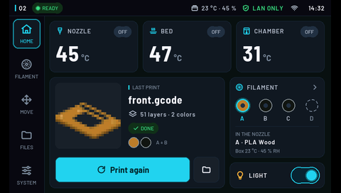
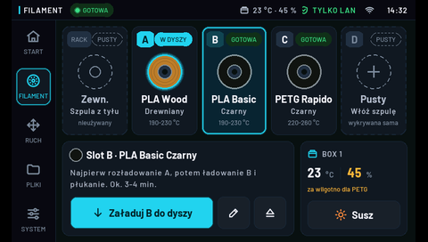
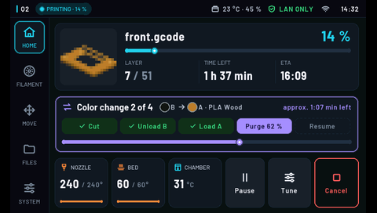
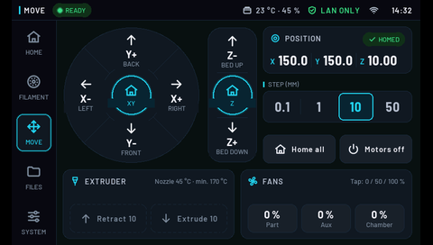

# qbdisplay_q2 – qbdisplay (Plus4 display UI) on the QIDI Q2 – PROTOTYPE

**EN** · [PL – wersja polska niżej](#polski)

[qbdisplay](https://github.com/CharlyBrownFR/qbdisplay-plus4) by CharlyBrownFR (GPL-3.0) is a new UI for
the QIDI Plus4 touch display. The Plus4 has a separate 800×480 TJC/Nextion display driven over a serial port;
the Q2 has a plain 480×272 LCD (`/dev/fb0`) with a Goodix touch panel, drawn by QIDI's screen program
`qidi-client`. This port adds two files and changes nothing in qbdisplay itself:

- `files/fbdisplay.py` – display driver with the same interface as qbdisplay's `TjcDisplay`: the TJC drawing
  commands are executed by qbdisplay's own simulator into an 800×480 image, scaled to 453×272 (black 13 px bars
  left/right) and written to `/dev/fb0`; Goodix touches are mapped back to 800×480; backlight and sleep.
- `files/q2main.py` – entry point (`python3 -m qbdisplay.q2main`).

Preview at the Q2's real resolution (480×272):

   

**Nothing is flashed.** The service is not started at boot: after a reboot QIDI's screen is back. Starting it
stops `qidi-client`; stopping it (or a crash) starts `qidi-client` again.

While qbdisplay runs, QIDI's screen program is off: no AI camera pop-ups, no resume after power loss, no QIDI
app/cloud, no plate calibration or updates from the screen, probably no automatic Box hot-plug handling.
Printing, Klipper, Fluidd and macros are unaffected. Box commands come from the Plus4 2.1.1 profile and are
**not verified on the Q2 yet**. The printer name shows "Q2"; "Check for updates" looks for QIDI Q2 releases on GitHub (QIDITECH/QIDI_Q2); the "To QIDI" button on the display does not work here – use `stop`.

Status: 🟡 tested in a simulator (render, framebuffer output, touch mapping, installer). Not yet on a printer.

## Use
```
ssh mks@PRINTER
cd /tmp
curl -sSLO https://raw.githubusercontent.com/shaggee/qidi-q2-notes/main/tools/qbdisplay_q2/qbdisplay_q2.py
sudo python3 qbdisplay_q2.py check
sudo python3 qbdisplay_q2.py install      # downloads qbdisplay 0.3.0 (pinned commit) to /usr/local/lib/qbdisplay-q2
sudo python3 qbdisplay_q2.py start        # qbdisplay on the screen
sudo python3 qbdisplay_q2.py stop         # back to QIDI's screen (a reboot does the same)
sudo python3 qbdisplay_q2.py log          # last log lines
sudo python3 qbdisplay_q2.py uninstall
```
Settings: `~/printer_data/config/qbdisplay.cfg` (`language: en|de`; touch in the wrong place →
`touch_swap_xy`, `touch_invert_x`, `touch_invert_y`).

---

# Polski

## qbdisplay_q2 – qbdisplay (interfejs ekranu z Plus4) na QIDI Q2 – PROTOTYP

[qbdisplay](https://github.com/CharlyBrownFR/qbdisplay-plus4) (CharlyBrownFR, GPL-3.0) to nowy interfejs ekranu
dotykowego QIDI Plus4. Plus4 ma osobny ekran TJC/Nextion 800×480 sterowany przez port szeregowy; Q2 ma zwykły
LCD 480×272 (`/dev/fb0`) z dotykiem Goodix, który rysuje program QIDI `qidi-client`. Ten port dodaje dwa pliki
i niczego nie zmienia w samym qbdisplay:

- `files/fbdisplay.py` – sterownik ekranu z tym samym interfejsem co `TjcDisplay`: polecenia rysowania wykonuje
  symulator qbdisplay w obrazie 800×480, który jest skalowany do 453×272 (czarne paski 13 px po bokach) i zapisywany
  do `/dev/fb0`; dotyk Goodix przeliczany z powrotem na 800×480; podświetlenie i usypianie.
- `files/q2main.py` – punkt startowy (`python3 -m qbdisplay.q2main`).

Podgląd w prawdziwej rozdzielczości Q2 – obrazki wyżej.

**Nic nie jest wgrywane.** Usługa nie startuje z systemem: po restarcie wraca ekran QIDI. Start zatrzymuje
`qidi-client`; zatrzymanie (albo awaria) uruchamia `qidi-client` z powrotem.

Gdy działa qbdisplay, program ekranu QIDI jest wyłączony: brak okienek kamery AI, wznawiania po zaniku prądu,
aplikacji/chmury QIDI, kalibracji płyty i aktualizacji z ekranu, prawdopodobnie też automatycznej obsługi
odłączenia Boxa. Druk, Klipper, Fluidd i makra działają normalnie. Polecenia Boxa pochodzą z profilu Plus4 2.1.1 i
**nie są jeszcze sprawdzone na Q2**. Nazwa drukarki to „Q2”; sprawdzanie aktualizacji szuka wydań QIDI Q2 na GitHubie (QIDITECH/QIDI_Q2); przycisk „To QIDI” na ekranie tu nie działa – użyj `stop`.

Status: 🟡 sprawdzone w symulatorze (rysowanie, zapis do framebuffera, przeliczanie dotyku, instalator).
Jeszcze nie na drukarce.

Użycie: polecenia wyżej (`check`, `install`, `start`, `stop`, `log`, `uninstall`). Ustawienia:
`~/printer_data/config/qbdisplay.cfg` (`language: en|de`; dotyk w złym miejscu → `touch_swap_xy`,
`touch_invert_x`, `touch_invert_y`).
